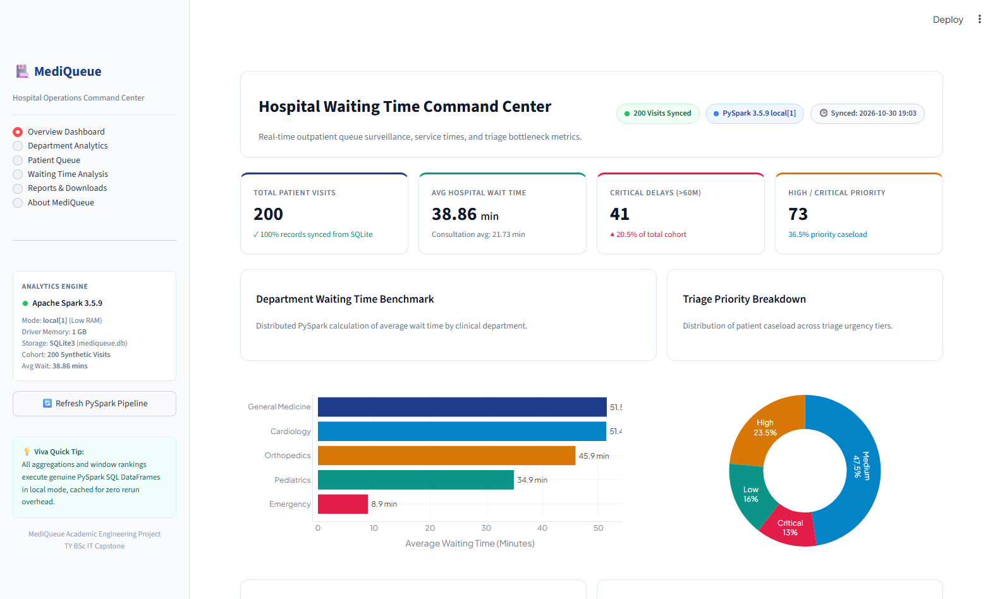
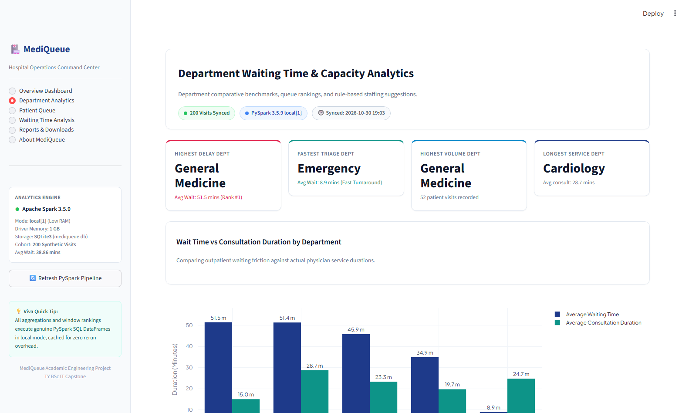
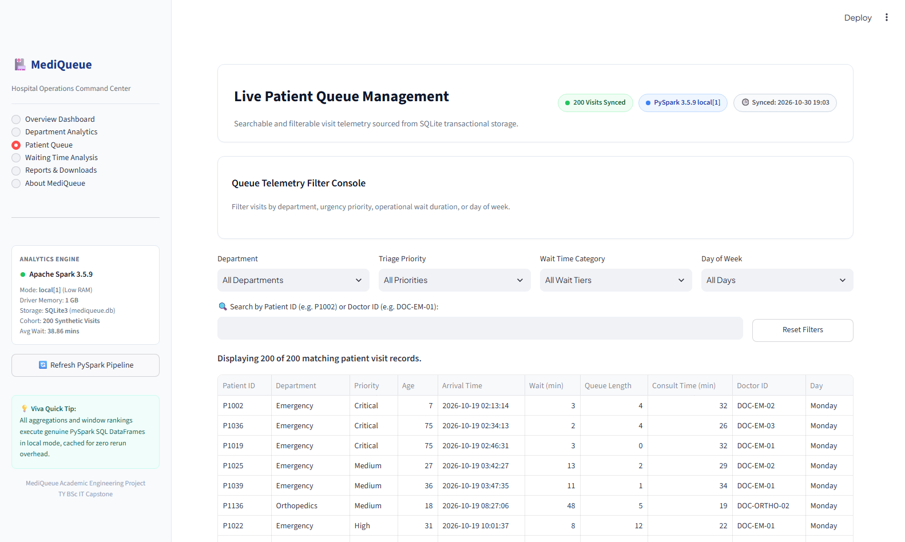
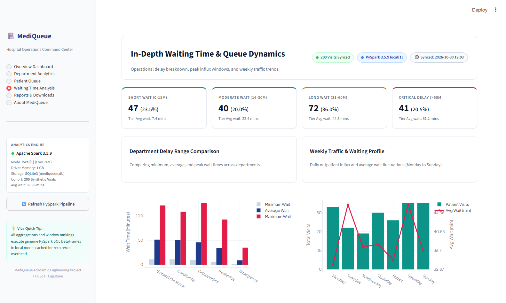
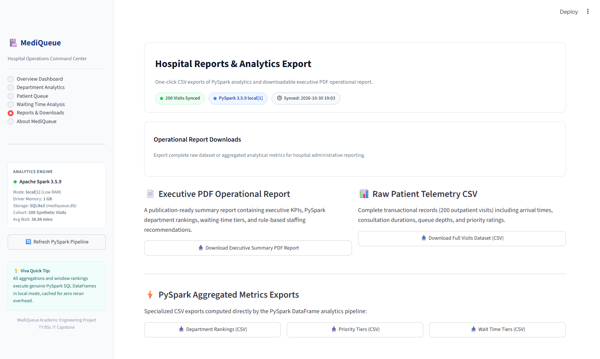
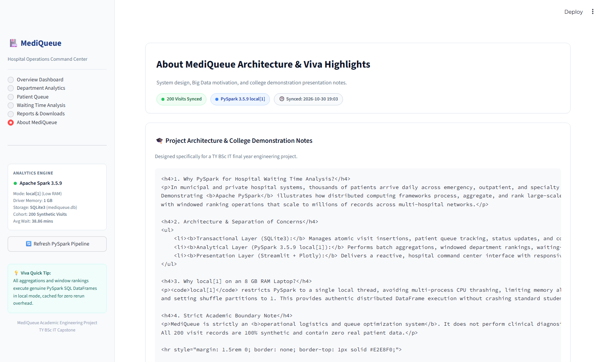

# 🏥 MediQueue – Big Data-Based Hospital Waiting Time Analysis and Queue Optimization System

[](https://www.python.org/)
[](https://streamlit.io/)
[](https://spark.apache.org/)
[](https://www.sqlite.org/)
[](https://plotly.com/)

A modern, professional, beginner-friendly college engineering project that demonstrates how Big Data processing techniques (**Apache PySpark**) and interactive web dashboards (**Streamlit**) can monitor, analyze, and optimize hospital outpatient waiting queues.

---

## 📌 Project Overview

In busy healthcare facilities, patient waiting time is one of the most critical indicators of operational efficiency and patient satisfaction. Prolonged queue delays lead to overcrowding, patient frustration, and uneven doctor workloads.

**MediQueue** solves this problem by providing:
1. **Real-time Queue Visibility:** Tracking patient flow from arrival, triage/registration, consultation, to completion.
2. **Big Data Processing with PySpark:** Utilizing Apache PySpark (`local[1]`) for distributed-style batch aggregations across department records.
3. **Queue Optimization & Wait Time Estimation:** Calculating estimated waiting times based on queue depth and department service velocity.
4. **Visual Analytics & Reporting:** Interactive Plotly charts and CSV export for operational reporting.

> **Important Academic Boundary:** MediQueue deals strictly with **operational waiting times and queue logistics**. It does **not** perform medical diagnosis or clinical emergency triage. All patient records use synthetic/demo data.

---

## 🚀 Key Features

- **📊 Central Dashboard:**
  - Spark-computed KPIs for total visits, average waits, critical delays, and urgent cases.
  - Global department, triage-priority, and weekday filters recalculate every analytic in PySpark.
  - Cached Spark results keep repeat interactions responsive.
- **👥 Patient Queue Management:**
  - Register new outpatient visits (Name, Age, Gender, Department, Priority).
  - Update patient status (`Waiting` ➔ `In Consultation` ➔ `Completed`).
  - Department filtering and live search.
- **⚡ PySpark Department Analysis:**
  - Department-wise average waiting time calculations.
  - Throughput analysis (patients treated per hour/day).
  - Identification of department bottlenecks.
  - Spark SQL DataFrame filters and window-function rankings drive the dashboard metrics.
- **📈 Reports & Visualization:**
  - Plotly bar charts and peak-hour distribution heatmaps.
  - CSV report export for hospital administration records.
- **⏱️ Smart Queue Estimation:**
  - Dynamic estimated waiting time calculated from the number of patients ahead and historical department service times.

---

## 🛠️ Technology Stack

| Layer | Technology | Purpose |
| :--- | :--- | :--- |
| **User Interface** | Streamlit | Clean, modern, responsive web dashboard |
| **Analytics Engine** | Apache PySpark (`local[1]`) | Big Data transformations, aggregations, and metrics |
| **Data Manipulation**| Pandas | Local tabular transformations and data export formatting |
| **Data Storage** | SQLite3 | Transactional storage for patient queue records |
| **Data Visualization**| Plotly | Interactive charts and queue distribution graphs |
| **Language** | Python 3.11 | Core application logic and data pipelines |

---

## 📂 Project Structure

```text
MediQueue/
├── data/
│   ├── hospital_visits.csv   # 200 realistic synthetic visit records
│   └── mediqueue.db          # Created locally at runtime; excluded from Git
├── packages.txt              # Java runtime required by PySpark on Streamlit Cloud
├── analytics.py              # PySpark analytics engine & metric transformers
├── app.py                    # Main Streamlit dashboard application
├── dashboard_helpers.py      # Cached PySpark/SQLite loaders, CSV & PDF generators
├── ui_components.py          # Command center styling, KPI cards & Plotly themes
├── database.py               # SQLite data access, validation & CRUD module
├── generate_data.py          # Synthetic dataset generator script
├── run_analytics.py          # Analytics demo runner & report generator
├── test_analytics.py         # PySpark analytics unit test suite (10 tests)
├── test_database.py          # Database unit test suite (18 tests)
├── requirements.txt          # Python dependencies
└── README.md                 # Project documentation and setup guide
```

---

## 🗄️ Data Layer & Database (Step 2)

### 1. Dataset Description (`data/hospital_visits.csv`)
The dataset consists of **200 synthetic outpatient and emergency visit records** designed to simulate real-world hospital waiting queue dynamics without using any real personal or patient data.

| Column | Data Type | Description | Allowed / Example Values |
| :--- | :--- | :--- | :--- |
| `patient_id` | TEXT (PK) | Unique synthetic patient identifier | `P1001` - `P1200` |
| `department` | TEXT | Clinical department | `Emergency`, `General Medicine`, `Cardiology`, `Orthopedics`, `Pediatrics` |
| `arrival_time` | TEXT | Timestamp when patient checked into queue | `YYYY-MM-DD HH:MM:SS` |
| `consultation_start` | TEXT | Timestamp when doctor began consultation | `arrival_time + waiting_time` |
| `consultation_end` | TEXT | Timestamp when consultation finished | `consultation_start + duration` |
| `doctor_id` | TEXT | Assigned physician ID | e.g. `DOC-EM-01`, `DOC-GM-02` |
| `priority` | TEXT | Triage urgency tier | `Low`, `Medium`, `High`, `Critical` |
| `patient_age` | INTEGER | Age of the patient | Realistic department-specific ranges |
| `queue_length` | INTEGER | Patients ahead in queue upon arrival | 0 to 16 |
| `waiting_time` | REAL / INT | Time spent waiting for doctor (minutes) | Non-negative numeric |
| `consultation_duration` | REAL / INT | Duration of consultation (minutes) | Non-negative numeric |
| `day_of_week` | TEXT | Day of arrival | `Monday` through `Sunday` |

#### Operational Characteristics:
- **Triage Dynamics:** `Critical` cases receive fast-track priority (avg. wait ~5 mins), while `Low` priority cases wait longer (avg. wait ~75 mins) based on queue congestion.
- **Department Variation:** `Emergency` handles around-the-clock urgent flows with shorter queue wait times; `Cardiology` and `Orthopedics` feature longer specialized consultation durations.
- **Queue Congestion Effect:** Peak arrival hours (09:30–13:30) reflect larger queue lengths and higher wait times.

---

### 2. SQLite Database Schema (created locally at `data/mediqueue.db`)

The database is built on SQLite3 and enforces constraints and query indexes:

```sql
CREATE TABLE IF NOT EXISTS hospital_visits (
    patient_id TEXT PRIMARY KEY,
    department TEXT NOT NULL,
    arrival_time TEXT NOT NULL,
    consultation_start TEXT NOT NULL,
    consultation_end TEXT NOT NULL,
    doctor_id TEXT NOT NULL,
    priority TEXT NOT NULL,
    patient_age INTEGER NOT NULL,
    queue_length INTEGER NOT NULL,
    waiting_time REAL NOT NULL,
    consultation_duration REAL NOT NULL,
    day_of_week TEXT NOT NULL,
    created_at TIMESTAMP DEFAULT CURRENT_TIMESTAMP
);

CREATE INDEX IF NOT EXISTS idx_visits_department ON hospital_visits (department);
CREATE INDEX IF NOT EXISTS idx_visits_priority ON hospital_visits (priority);
CREATE INDEX IF NOT EXISTS idx_visits_arrival_time ON hospital_visits (arrival_time);
CREATE INDEX IF NOT EXISTS idx_visits_doctor ON hospital_visits (doctor_id);
```

---

### 3. Data Validation Rules

The database module enforces strict validation rules before committing records:
- **Unique Patient Identifier:** Duplicate `patient_id` values are rejected (`ValidationError`).
- **Valid Categoricals:** `department` and `priority` must match allowed clinical categories.
- **Non-Negative Constraints:** `waiting_time >= 0`, `consultation_duration >= 0`, `patient_age >= 0`, and `queue_length >= 0`.
- **Mandatory Fields:** Missing or blank required fields are rejected.
- **Safe CSV Ingestion:** Malformed CSV rows (missing columns, invalid timestamps, or out-of-range values) are captured into an error log and skipped without halting the overall import.

---

### 4. How to Initialize the Database & Import Data

You can initialize the database and import the 200 sample visits by running:

```powershell
python database.py
```

Or programmatically in Python:
```python
import database

# Initialize database schema and indexes
database.init_db()

# Import the sample CSV dataset
result = database.import_csv("data/hospital_visits.csv")
print(f"Imported: {result['imported']}, Skipped: {result['skipped']}")

# Retrieve basic statistics
stats = database.get_database_stats()
print(f"Total Visits: {stats['total_visits']}, Avg Wait: {stats['avg_waiting_time']} min")
```

---

### 5. How to Run Database Unit Tests

A comprehensive unit test suite with 18 automated tests covers schema creation, CRUD operations, CSV ingestion, validation errors, and statistical aggregations:

```powershell
python test_database.py -v
```

All tests run in an isolated in-memory or temporary database without mutating the production `data/mediqueue.db`.

---

## ⚡ PySpark Analytics Engine (Step 3)

### 1. Why PySpark for MediQueue?
Healthcare outpatient queues generate continuous telemetry across multiple facilities, specialty departments, and triage stations. While standard databases handle row-by-row transactions (check-ins and status updates), **Apache PySpark** provides:
- **Scalable Batch Aggregations:** Distributed dataframe operations (`groupBy`, `agg`, `Window`) capable of scaling from local demonstration to massive multi-hospital datasets without code refactoring.
- **Analytical Separation of Concerns:** Eliminates heavy analytical query loads from the transactional SQLite database, ensuring real-time patient queue operations remain responsive.
- **Enterprise-Grade Data Transformations:** Utilizes Spark SQL expressions for dynamic tier classifications, time-series hour extractions, and windowed rankings.

### 2. Lightweight `local[1]` Spark Configuration
Configured specifically for low-overhead execution on student laptops (8 GB RAM):
- **Master:** `local[1]` (runs in a single thread, minimizing CPU context switching and RAM usage).
- **Driver Memory:** Limited to `1g`.
- **Shuffle Partitions:** Explicitly configured to `1` (`spark.sql.shuffle.partitions = 1`) to eliminate the overhead of creating 200 default shuffle tasks for local workloads.
- **UI Overhead:** Disabled (`spark.ui.enabled = false`) to conserve system ports and background threads.
- **Log Level:** Suppressed to `ERROR` (`sc.setLogLevel("ERROR")`) to keep console outputs clean.
- **Worker Environment:** Dynamically synchronizes `PYSPARK_PYTHON` and `PYSPARK_DRIVER_PYTHON` with the active runtime executable (`sys.executable`).

### 3. Analytics Modules (`analytics.py`)
The engine wraps a PySpark DataFrame in `MediQueueAnalytics` to perform:
1. **Overall Facility Metrics (`compute_overall_stats`):**
   Total patient visits, average/minimum/maximum waiting times, average consultation duration, and urgent case count (High + Critical).
2. **Department Analytics & Ranking (`compute_department_analytics`):**
   Department-wise visits, average wait times, max wait times, and consultation times, assigned a dense rank based on wait-time severity.
3. **Clinical Priority Profiling (`compute_priority_analytics`):**
   Aggregates waiting times across `Critical`, `High`, `Medium`, and `Low` priority tiers.
4. **Waiting-Time Classification Tiers (`compute_waiting_time_classification`):**
   Segments patients into 4 operational tiers using Spark SQL `when/otherwise`:
   - *Short Wait:* 0–15 minutes
   - *Moderate Wait:* 16–30 minutes
   - *Long Wait:* 31–60 minutes
   - *Critical Delay:* Above 60 minutes
5. **Peak Hour Analysis (`compute_peak_hour_analysis`):**
   Extracts arrival hours directly from timestamps to compute patient arrivals, average wait, and queue depth per hour.
6. **Day-wise Traffic (`compute_day_wise_analysis`):**
   Aggregates weekly visit patterns and day-specific average wait times.
7. **Operational Rule-Based Insights (`generate_insights`):**
   Extracts highest/lowest wait departments, peak arrival hours, critical delay percentages, and actionable staffing recommendations.
   > **Academic Boundary Note:** These insights are descriptive analytics and rule-based operational recommendations derived from PySpark aggregations, not machine-learning predictions.

### 4. How to Execute the Analytics Demo
Run the terminal analytics runner:
```powershell
python run_analytics.py
```

### 5. How to Run PySpark Analytics Tests
Run the automated PySpark test suite (10 unit tests):
```powershell
python -m unittest test_analytics.py -v
```

---

## 🖥️ Streamlit Command Center Dashboard (Step 4)

MediQueue features an interactive, healthcare operations command center built with **Streamlit** and **Plotly**. The interface uses a clean navy-and-teal visual design tailored for clinical operations monitoring.

### 1. Dashboard Navigation Sections
- **Overview Dashboard:**
  - Real-time KPI cards: Total Patient Visits, Average Waiting Time, Critical Delays (>60m), and Urgent Priority cases.
  - Department waiting time horizontal bar chart.
  - Clinical priority donut chart.
  - Operational waiting-time tier distribution.
  - Hourly patient influx area chart.
  - Recent visits transaction log.
- **Department Analytics:**
  - Side-by-side comparison of Average Wait Time vs Average Consultation Duration.
  - Ranked department league table powered by PySpark Window `dense_rank()`.
  - Rule-based staffing recommendations based on wait time thresholds.
- **Patient Queue (Interactive Telemetry):**
  - Searchable and multi-filterable patient visit table.
  - Filters by Department, Triage Priority, Wait Category, and Day of Week.
  - Search by Patient ID or Assigned Doctor ID.
- **Waiting Time Analysis:**
  - 4 Tier breakdown cards (Short Wait, Moderate Wait, Long Wait, Critical Delay) with percentages and average durations.
  - Department delay range comparison (Min, Avg, Max).
  - Weekly traffic fluctuations and dual-axis wait time trends.
  - Hourly queue density against average queue length.
- **Reports & Downloads:**
  - Download full 200 visit records as CSV.
  - Download PySpark aggregated metrics (Department rankings, Priority breakdowns, Wait tiers) as CSV.
  - One-click **Executive Summary PDF Report** generated dynamically via ReportLab.
- **About MediQueue:**
  - College viva highlights, Big Data architecture rationale, and operational scope boundaries.

### 2. PySpark Streamlit Caching
The sidebar exposes global department, triage-priority, and weekday controls. Each selection is applied to the Spark DataFrame before its aggregations and rankings are recalculated, so the KPIs, charts, recommendations, report, and queue view all follow the active cohort. Results are cached using `@st.cache_data` to keep repeat selections responsive without spawning redundant Spark sessions. The queue page adds wait-tier and patient/doctor search filters.

---

## ⚙️ Setup and Installation

### 1. Prerequisites
- **Python 3.10+** (Tested on Python 3.11)
- **Java (JDK 8, 11, or 17)** (Required by Apache Spark)

### 2. Create and Activate Virtual Environment
Open PowerShell or your command terminal in the `MediQueue` project folder:

```powershell
# Navigate to the project directory
cd "C:\Users\JAGRUTI\.gemini\antigravity\scratch\MediQueue"

# Create a virtual environment
python -m venv .venv

# Activate the virtual environment (Windows PowerShell)
.\.venv\Scripts\Activate.ps1
```

### 3. Install Dependencies
```powershell
pip install -r requirements.txt
```

### 4. Run the Streamlit Application
```powershell
streamlit run app.py
```

The application will start and open automatically in your browser at `http://localhost:8501`.

### Deploying on Streamlit Community Cloud
The repository's `packages.txt` installs the Java 17 runtime required to start PySpark. Keep this file at the repository root so Community Cloud installs Java before launching the app.

---

## 🎓 College Viva & Discussion Notes

- **Why PySpark for a hospital queue?**  
  In high-volume hospital networks, millions of patient visits and telemetry points are logged continuously. Demonstrating PySpark showcases how distributed computing scales to aggregate multi-department queue metrics efficiently.
- **Why `local[1]`?**  
  `local[1]` configures Spark to run locally using a single worker thread, minimizing memory overhead on student laptops while executing genuine Spark RDD/DataFrame code.
- **Separation of Concerns:**  
  SQLite handles transactional operations (adding patients, updating queue statuses), while PySpark handles analytical workloads (aggregations, peak-hour calculations).

---

## 📸 Application Screenshots

The interface is designed with a modern healthcare operations command center aesthetic using navy and teal accents.

### 1. Overview Dashboard

*Real-time hospital operations command center with executive KPI cards, department waiting time bar chart, priority donut chart, wait tier distribution, and hourly patient arrival trends.*

### 2. Department Analytics

*Side-by-side comparison of Average Wait Time vs Consultation Duration, PySpark Window `dense_rank()` league table, and rule-based staffing recommendations.*

### 3. Live Patient Queue Management

*Searchable and multi-filterable outpatient queue telemetry sourced from SQLite transactions with instant filter resets and doctor/patient ID search.*

### 4. In-Depth Waiting Time Analysis

*Breakdown of the 4 operational waiting tiers, department delay ranges (Min/Avg/Max), weekly influx trends, and hourly queue depth density.*

### 5. Reports & Analytics Export

*One-click downloadable Executive Summary PDF report generated via ReportLab and CSV exports of raw data and PySpark aggregated metrics.*

### 6. About MediQueue & Architecture

*System architecture breakdown, Big Data motivation, and college viva examiner question cheat sheet.*

---

## 🏛️ System Architecture

```text
┌────────────────────────────────────────────────────────────────────────┐
│                        PRESENTATION LAYER                              │
│             Streamlit Web Command Center (app.py)                      │
│   • 6 Navigation Pages       • KPI Cards & Layout (ui_components.py)   │
│   • Interactive Plotly SVGs  • ReportLab Executive PDF Exporter        │
└───────────────────────────────────▲────────────────────────────────────┘
                                    │ Cached via @st.cache_data
┌───────────────────────────────────┴────────────────────────────────────┐
│                    ANALYTICS LAYER (PySpark local[1])                  │
│                     analytics.py / run_analytics.py                    │
│   • PySpark DataFrame API    • Window Functions (dense_rank)           │
│   • GroupBy & Aggregations   • Waiting Tier SQL Classifications        │
│   • Peak Hour Time Parsing   • Rule-Based Staffing Recommendation      │
└───────────────────────────────────▲────────────────────────────────────┘
                                    │ Ingests from SQLite & CSV
┌───────────────────────────────────┴────────────────────────────────────┐
│                        DATA & STORAGE LAYER                            │
│                        database.py (SQLite3)                           │
│   • mediqueue.db (Indexed)   • data/hospital_visits.csv (200 records)   │
│   • ACID Validation & CRUD   • No Real Patient Data (100% Synthetic)   │
└────────────────────────────────────────────────────────────────────────┘
```

---

## 🎓 College Demonstration & Viva Resources

To assist TY BSc IT students during college practical examinations, capstone reviews, and external vivas, comprehensive documentation is included:

- 📋 **[College Demonstration Guide](DEMO_GUIDE.md):** Step-by-step walkthrough script for presenting all 6 dashboard views to examiners, explaining PySpark aggregations, and demonstrating filter/export capabilities.
- 💡 **[Viva Voce Questions & Answers](VIVA_QUESTIONS.md):** 20 curated technical questions and concise, student-friendly answers covering Big Data, Spark local[1], DataFrames, dense_rank(), SQLite OLTP vs PySpark OLAP, caching, and why Machine Learning is not used.

---

## 📍 Project Roadmap
- [x] **Step 1:** Workspace inspection, directory setup, starter Streamlit app, `requirements.txt`, and `README.md`.
- [x] **Step 2:** SQLite database schema setup, 200-record synthetic patient dataset, CRUD operations, validation, and test suite.
- [x] **Step 3:** PySpark analytical pipeline (`local[1]`) for queue metrics, department rankings, peak hours, and rule-based insights.
- [x] **Step 4:** Interactive dashboard, patient queue interface, department analysis, Plotly charts, and ReportLab PDF reporting.
- [x] **Step 5:** Final integration, quality audit, UI polish, examiner demonstration notes & test verification.
- [x] **Step 6:** Final testing, high-resolution screenshots & college demonstration preparation.
